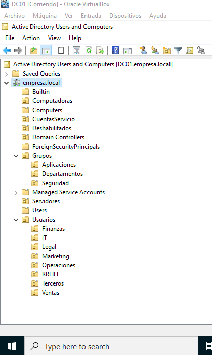
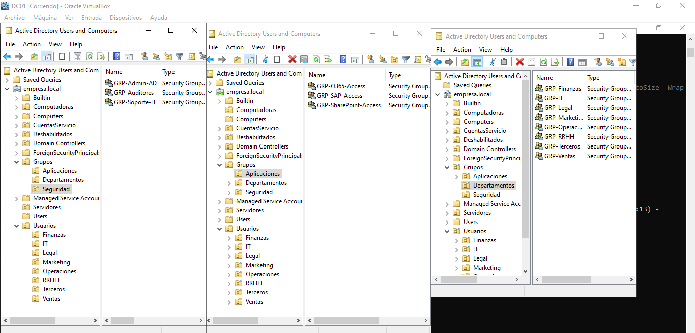
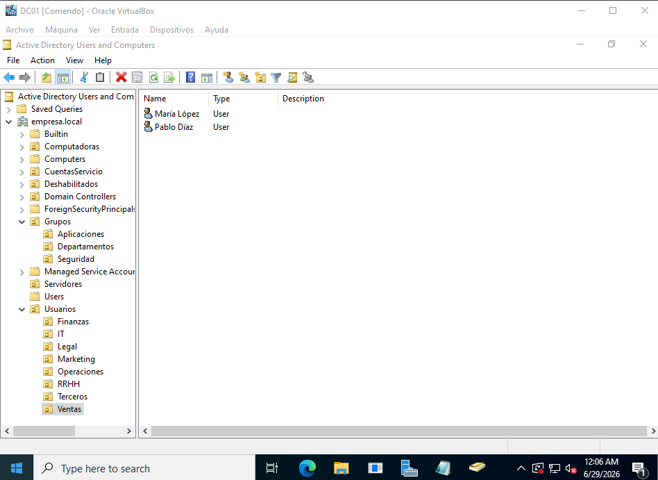
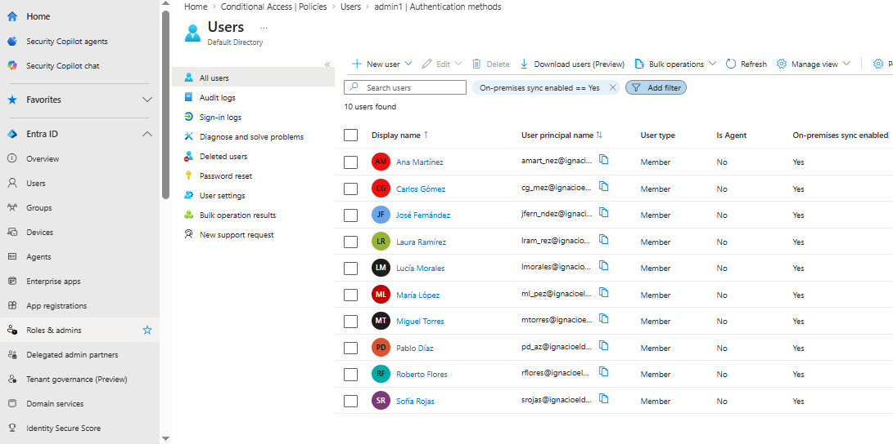
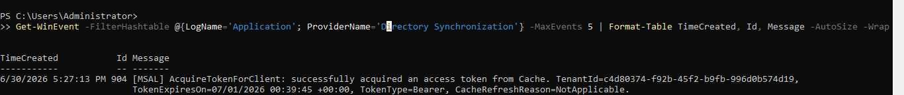

# IAM Automation - Active Directory + Microsoft Entra ID (Hybrid)

[](https://github.com/)
[](https://github.com/)
[](https://github.com/)
[](https://github.com/)

---

## Descripción del Proyecto

Este proyecto demuestra la automatización de ABM (Altas, Bajas y Modificaciones) en un entorno híbrido de Active Directory + Microsoft Entra ID.

---

## Habilidades Demostradas

- Administración de Active Directory
- Automatización de ABM con PowerShell
- RBAC (Role-Based Access Control)
- Entorno Híbrido (AD + Entra ID)
- Sincronización de identidades
- Password Hash Sync

---

## Tecnologías Utilizadas

- Windows Server 2022
- Active Directory
- Microsoft Entra ID
- Microsoft Entra Connect
- PowerShell
- Git
- VirtualBox

---

## Estructura del Proyecto

```
IAM-Hybrid-AD-EntraID/
├── README.md
├── Scripts/
│   ├── New-ADUsersBulk.ps1
│   └── users.csv
├── Docs/
│   ├── manual-setup.md
│   └── troubleshooting.md
└── Screenshots/
    ├── ad-estructura-ous.png
    ├── ad-ventas.png
    └── ad-it.png
    
```


---

## Como Ejecutar

1. Configurar estructura de OUs (Manual)
2. Crear usuarios desde CSV:

```
   .\Scripts\New-ADUsersBulk.ps1
```

3. Verificar sincronización:

```
   Get-ADSyncScheduler | Select-Object LastSyncTime
```   

---

## Ejemplo de CSV

```

FirstName,LastName,Department,JobTitle,ManagerEmail,Office
Maria,Lopez,Ventas,Directora Comercial,admin@empresa.local,Buenos Aires
Carlos,Gomez,IT,Ingeniero de Sistemas,admin@empresa.local,CABA

```
---

## Resultados

- Usuarios procesados: 10
- Usuarios creados: 10
- Errores: 0
- Sincronización a Azure: Exitosa

---

## Contacto

Autor: Ignacio Cornejo

LinkedIn: https://www.linkedin.com/in/ignacio-cornejo/

Email: ignacio06cornejo@gmail.com

---

## Licencia

MIT License

---

---

## 📸 Galería de Capturas

### 1. Estructura de Active Directory (OUs)


### 2. Grupos de Seguridad y RBAC


### 3. Usuarios creados por Departamento


### 4. Identidades Sincronizadas en Microsoft Entra ID


### 5. Auditoría y Diagnóstico (Event Viewer)

